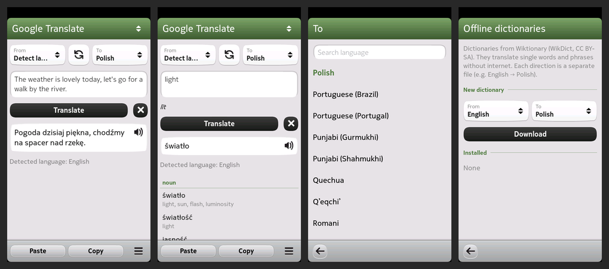

# MeeTranslate for the Nokia N9

*Opis po polsku poniżej.*

A translator for the Nokia N9 (MeeGo Harmattan PR1.3), written in 2026, with the look of
TAO Translator. Designed and written by Claude (Anthropic) together with smyhu.



- **Google Translate:** whole sentences, a dictionary for single words (parts of speech,
  reverse translations), transliteration and language detection. About 250 languages, with
  search in the language list.
- **MyMemory** as a second online service. When Google does not answer, the app switches to
  MyMemory by itself (can be turned off in Settings).
- **Offline dictionaries** from [WikDict](https://www.wikdict.com) (built from Wiktionary):
  26 languages, one download per direction (e.g. English → Polish, about 16 MB to download
  and 8 MB on the phone). Exact word plus similar entries. Without internet the app uses the
  offline dictionary by itself.
- **No internet:** the app checks for a connection before every request, so the phone does not
  keep asking you to choose a Wi-Fi network. It says clearly when there is no internet.
- **Reading aloud** of the translation (Google voice, needs internet).
- **Languages:** Polish, English, German, Spanish, Italian and French, following the phone
  language. Any other language falls back to English.
- Light theme by default, dark theme in Settings. Paste and Copy on the toolbar.

## Install

Copy `dist/meetranslate_0.1.1_armel.deb` to `/home/developer` on the phone (`/tmp` on the N9
has only 4 MB), then as root (developer mode):

```
aegis-dpkg -i /home/developer/meetranslate_0.1.1_armel.deb
```

Requirements: Python 2.6, PySide and Qt Components, all present on a standard PR1.3 phone.
HTTPS needs a TLS 1.2 capable QtNetwork (the community TLS patch). Without it, Google is asked
over plain HTTP.

## Layout

| Part | What it does |
|---|---|
| `src/main.py` | PySide launcher: network helper processes, offline dictionaries, speech, settings |
| `src/dictprep.py` | slims a downloaded WikDict file to the word table and indexes it |
| `src/qml/` | UI (Harmattan Qt Components), services and parsing (`translator.js`), translations (`strings.js`) |
| `helper/` | `meetranslate-fetch`, a small C++/Qt program that does all HTTP(S) requests, its source and cross-build script |
| `packaging/` | Debian control file, launcher entry, copyright |

`./build-deb.sh` builds the package into `dist/`.

The network work is done in a separate process on purpose: QtNetwork inside Python crashes on
the N9 when the TLS patch is installed (Python carries the old OpenSSL 0.9.8, the patch makes
Qt load OpenSSL 1.0.x).

## Licences and data

- MeeTranslate: MIT (`LICENSE`).
- Google Translate and Google text-to-speech are used through their unofficial public
  endpoints; MyMemory through its public API.
- WikDict dictionaries are CC BY-SA 3.0 (Wiktionary). They are downloaded by the user and are
  not part of this repository or the package.
- The look follows TAO Translator by Oleksii Serdiuk; no code was taken from it.

---

## Po polsku

Tłumacz dla Nokii N9 (MeeGo Harmattan PR1.3), napisany w 2026 r., w wyglądzie TAO
Translator. Zaprojektowany i napisany przez Claude (Anthropic) wspólnie ze smyhu.

- **Google Tłumacz:** całe zdania, słownik dla pojedynczych słów, transliteracja, wykrywanie
  języka. Ok. 250 języków z wyszukiwarką.
- **MyMemory:** zapasowe źródło online, włączane samo, gdy Google nie odpowiada.
- **Słowniki offline WikDict** (z Wiktionary): 26 języków, każdy kierunek osobno. Bez
  internetu aplikacja sama sięga do słownika.
- **Bez internetu** aplikacja nie próbuje się łączyć (system nie pyta o sieć Wi-Fi) i jasno
  o tym informuje.
- **Czytanie na głos** tłumaczenia (głos Google, wymaga internetu).
- **Sześć języków** interfejsu, zależnie od języka telefonu.

Instalacja: skopiuj `dist/meetranslate_0.1.1_armel.deb` do `/home/developer` w telefonie i jako
root (tryb dewelopera) uruchom `aegis-dpkg -i /home/developer/meetranslate_0.1.1_armel.deb`.
